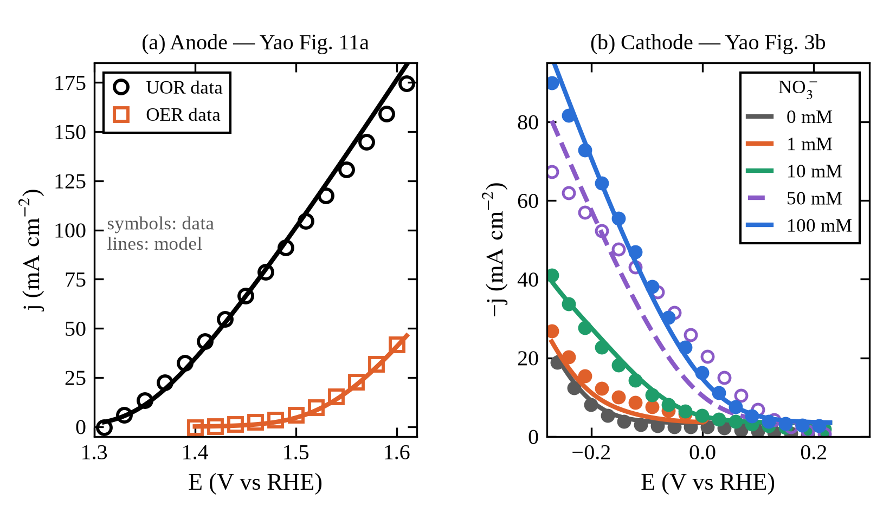
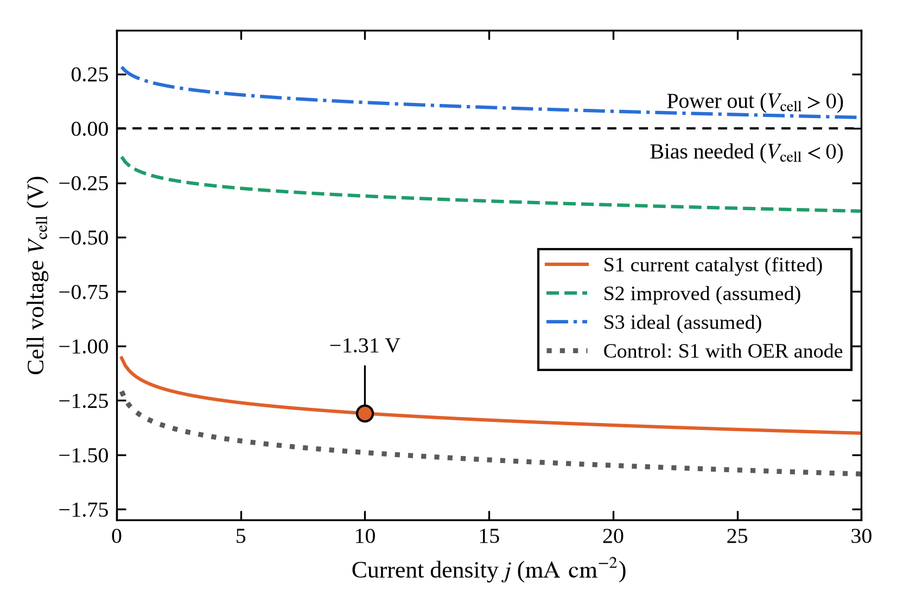
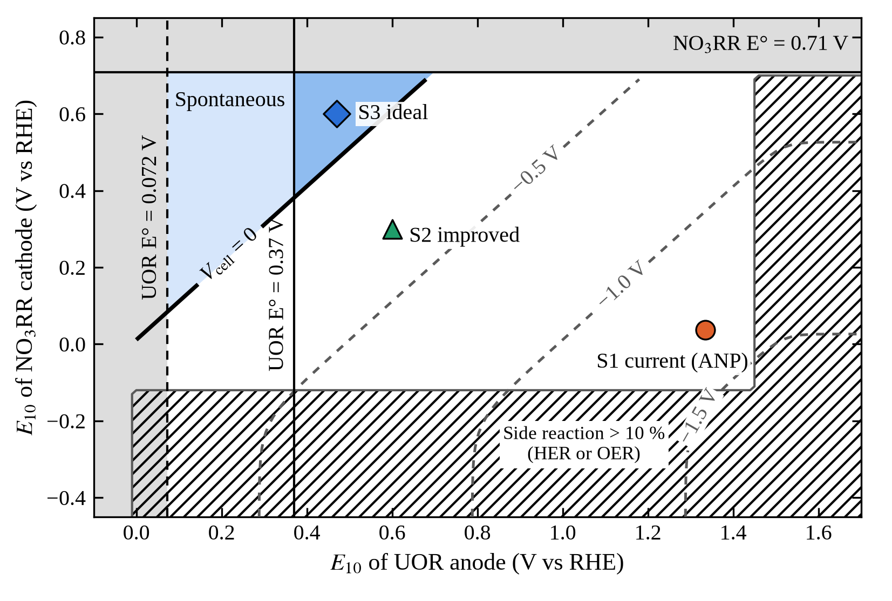

# Urea-Nitrate-Direct-Cell

[](https://github.com/Shuruyue/Urea-Nitrate-Direct-Cell/actions/workflows/ci.yml)


## Urea–Nitrate Direct Cell Model

A thermodynamics, kinetics and mass-transport model of a direct electrochemical cell in which **urea is oxidized at the anode (UOR)** and **nitrate is reduced to ammonia at the cathode (NO₃RR)**. Urea acts as the fuel and nitrate as the oxidant, so two nitrogen pollutants are treated in one cell. The model asks how good the catalysts must be for the cell to run without external power, and how dilute nitrate limits real operation.

Kinetic and mass-transport parameters of the current-catalyst scenario are fitted to LSV data digitized from Yao et al., *Sustainability* **17**, 3835 (2025) (CC BY 4.0).

All potentials are V vs RHE at pH 14 and 25 °C; current densities are in mA cm⁻².

## Project Overview

### Core Features

- **Thermodynamics** — standard potentials recomputed from ΔfG° (NBS tables), E°cell and ΔG° for three literature values of the UOR potential, Nernst shift on dilution.
- **Electrode kinetics** — Tafel kinetics anchored at E₁₀ (potential at 10 mA cm⁻²), side reactions (OER at the anode, HER at the cathode) included, so Faradaic efficiencies are computed rather than assumed.
- **Mass transport** — Koutecký–Levich coupling of NO₃RR kinetics with the diffusion-limited current, with a fitted reaction order.
- **Full-cell solver** — both electrode potentials solved from current balances with Brent's method; polarization and power curves.
- **Operating-mode map** — cell voltage over the (anode E₁₀, cathode E₁₀) plane from the full model, with spontaneous and side-reaction regions.
- **Batch treatment** — Faradaic-law integration of nitrate removal under constant current or concentration-following current; energy per kg N.
- **Calibration** — least-squares fit to published LSV curves including an uncompensated-resistance term; one curve held out as an independent test.
- **Validation** — 47 automated checks plus unit tests, run in CI on every push.

## Quick Start

### Installation

```bash
git clone https://github.com/Shuruyue/Urea-Nitrate-Direct-Cell.git
cd Urea-Nitrate-Direct-Cell
pip install -e ".[dev]"
```

### Usage

```bash
python scripts/summary.py         # main results → outputs/results.json
python scripts/calibrate.py       # parameter fit to Yao et al. 2025 → outputs/calibration_result.json
python scripts/make_figures.py    # all figures → docs/figures/
```

```python
from urea_nitrate_cell import model as m

r = m.solve_cell(10.0, m.S1)              # current catalyst, 10 mA cm-2, 100 mM nitrate
print(r["V"], r["Ea"], r["Ec"])           # -1.309  1.335  0.036
batch = m.simulate_batch(m.S1, "follow")  # 60 mg N/L, concentration-following current
print(batch["FE_avg"], batch["t_end"])    # 0.742  2.65 h
```

### Validation Scripts

```bash
pytest -q                               # unit tests + full validation suite
python scripts/validate.py --markdown   # 47 checks → outputs/validation_table.json and VALIDATION.md
```

`scripts/validate.py` exits with code 1 if any check fails. The full table is in [VALIDATION.md](VALIDATION.md).

## Project Structure

```
Urea-Nitrate-Direct-Cell/
├── urea_nitrate_cell/
│   ├── model.py         # thermodynamics, kinetics, full-cell solver, sensitivity, batch simulation
│   ├── yao2025.py       # LSV data digitized from Yao et al. 2025 (Figs. 3b, 11a, 14d)
│   ├── calibration.py   # least-squares parameter fit with uncompensated resistance
│   ├── validation.py    # 47 automated checks (run_all)
│   ├── summary.py       # main results (compute)
│   └── plotting.py      # figures (14 cm wide, 300 dpi)
├── scripts/             # command-line entry points
├── tests/               # pytest: unit tests and full validation
├── docs/figures/        # generated figures
├── VALIDATION.md        # check-by-check validation table
└── outputs/             # generated JSON (git-ignored)
```

## Theoretical Background

### Reactions (pH 14)

$$\mathrm{CO(NH_2)_2 + 6OH^- \rightarrow N_2 + 5H_2O + CO_2 + 6e^-}$$

$$\mathrm{NO_3^- + 6H_2O + 8e^- \rightarrow NH_3 + 9OH^-}$$

$$\mathrm{4CO(NH_2)_2 + 3NO_3^- \rightarrow 4N_2 + 4CO_2 + 3NH_3 + 2H_2O + 3OH^-}$$

With E°(NO₃⁻/NH₃) = 0.71 V and E°(UOR) = 0.37 V (commonly cited), 0.072 V (from ΔfG°, CO₂ product) or −0.025 V (CO₃²⁻ product), the standard cell potential is **+0.34, +0.64 or +0.73 V** and ΔG° = −261, −491 or −566 kJ per mol NO₃⁻: the overall reaction is spontaneous.

### Full-cell model

$$V_\mathrm{cell}(j) = E_\mathrm{c}(j) - E_\mathrm{a}(j) - jR_\Omega$$

$$j = j_\mathrm{UOR}(E_\mathrm{a}) + j_\mathrm{OER}(E_\mathrm{a}), \qquad j = j_\mathrm{NO_3RR}(E_\mathrm{c}) + j_\mathrm{HER}(E_\mathrm{c})$$

$$j_\mathrm{k}(\eta) = j_0\left(10^{\eta/b}-1\right), \qquad j_0 \text{ set by } j_\mathrm{k}(E_{10}) = 10\ \mathrm{mA\ cm^{-2}}$$

$$\frac{1}{j_\mathrm{NO_3RR}} = \frac{1}{j_\mathrm{k}\,(C/C_\mathrm{ref})^{\gamma}} + \frac{1}{j_\mathrm{lim}}, \qquad j_\mathrm{lim} = \frac{nFDC}{\delta}$$

### Batch treatment

$$\frac{dC}{dt} = -\frac{\mathrm{FE}_\mathrm{NO_3RR}\, jA}{nFV}, \qquad w = \frac{\int V_\mathrm{cell}\, I\, dt}{m_\mathrm{N}}$$

Explicit Euler with a 10 s step; reducing the step to 2 s changes treatment time and energy by less than 0.2 %.

### Calibration

The measured LSV potential contains an uncompensated ohmic drop, so the fit uses $E_\mathrm{true} = E_\mathrm{meas} \mp jR_\mathrm{u}$ (− anode, + cathode). The cathode is fitted to the 0, 1, 10 and 100 mM curves (127 points); the 50 mM curve is held out.



## Parameters

| Parameter | Value | Source |
|---|---|---|
| UOR: E₁₀, b | 1.335 V, 44.2 mV/dec | Yao 2025 (reported); reproduces Fig. 11a with 8.5 % RMS error |
| OER: E₁₀, b | 1.515 V, 60 mV/dec | E₁₀ reported; b fitted to Fig. 11a |
| NO₃RR: E₁₀, b (100 mM) | +0.037 ± 0.005 V, 99 ± 5 mV/dec | fitted to Fig. 3b |
| Reaction order γ | 1 (free fit 0.87 ± 0.13) | fitted to Fig. 3b |
| HER: E₁₀, b | −0.202 ± 0.004 V, 81 ± 10 mV/dec | fitted to Fig. 3b (0 mM) |
| Diffusion layer δ | 43 ± 6 µm | fitted to Fig. 3b |
| NO₃⁻ diffusion coefficient D | 1.902 × 10⁻⁵ cm² s⁻¹ | CRC Handbook |
| Ohmic resistance R_Ω | 1 Ω cm² | assumed (zero-gap AEM cell) |
| Scenarios S2, S3 | see `model.py` | assumed improved / ideal catalysts |

## Key Results

At 10 mA cm⁻² and 100 mM nitrate:

| Scenario | E_a (V) | E_c (V) | V_cell (V) |
|---|---|---|---|
| S1 current catalyst (fitted) | 1.335 | +0.036 | −1.31 |
| Control: S1 with OER-only anode | 1.515 | +0.036 | −1.49 |
| S2 improved (assumed) | 0.600 | +0.299 | −0.31 |
| S3 ideal (assumed) | 0.470 | +0.599 | +0.12 |

- With the current catalyst the cell needs about 1.31 V of external bias; urea lowers the required voltage by 0.18 V (12 %) relative to an OER anode.
- Self-powered operation requires η_anode + η_cathode + jR_Ω < E°cell (0.34 V, or 0.64 V with E°UOR = 0.072 V). The larger gap is at the anode (0.97 V vs 0.67 V), consistent with UOR proceeding via Ni²⁺/Ni³⁺ near 1.32 V.
- Only the assumed S3 delivers power: 1.6 mW cm⁻² at 23 mA cm⁻².
- In a 60 mg N L⁻¹ batch, a concentration-following current raises the average Faradaic efficiency from 46 % to 74 % and cuts energy use by 41 %, at the cost of 46 % longer treatment.





## Validation

| Category | Checks | Examples |
|---|---|---|
| Stoichiometry | 4 | atom and charge balance of every reaction |
| Thermodynamics | 7 | E° from ΔfG° vs literature; ΔG° = −nFE°; Nernst shift 22.2 mV |
| Kinetics | 7 | current at E₁₀ equals 10 mA cm⁻²; numerical Tafel slope equals input |
| Mass transport | 4 | j_lim vs hand calculation; both Koutecký–Levich limits |
| Numerics | 5 | residuals < 10⁻⁸ mA cm⁻²; monotonic potentials; 0 ≤ FE ≤ 1; analytic inverse |
| Calibration / independent test | 11 | reproduces published LSV (8.5 %, 7 % RMS); 180 mV UOR–OER gap; held-out 50 mM curve |
| Batch | 8 | mass balance; Faradaic-law hand check; time-step convergence; energy sign |
| Operating-mode map | 1 | straight-line approximation within 4 mV where side reactions are negligible |

Calibration is not independent validation: the S1 parameters are fitted to the same LSV curves, and no independent full-cell data are yet available to test the absolute cell voltage. The held-out 50 mM curve deviates by 29 % RMS; in the source data it lies above the 100 mM curve near 0 V vs RHE, against the trend of the other concentrations.

## Limitations

S1 is fitted to a single study; S2, S3 and R_Ω are assumptions. The model uses single Tafel slopes, a fixed diffusion layer and HER kinetics unaffected by nitrate, and does not include by-products (nitrite, over-oxidation of urea), pH drift or membrane potentials.

## References

1. Q. Yao, Y. Xiao, H. Wang, H. Zhong, T. Wang, *Sustainability* **17**, 3835 (2025). [doi:10.3390/su17093835](https://doi.org/10.3390/su17093835) — source of the digitized LSV data (CC BY 4.0).
2. B. K. Boggs, R. L. King, G. G. Botte, *Chem. Commun.* 2009, 4859–4861. [doi:10.1039/b905974a](https://doi.org/10.1039/b905974a)
3. K. S. Anuratha et al., *Nanomaterials* **12**, 2970 (2022). [doi:10.3390/nano12172970](https://doi.org/10.3390/nano12172970)
4. V. S. Protsenko, *Int. J. Hydrogen Energy* **48**, 24207–24211 (2023). [doi:10.1016/j.ijhydene.2023.03.295](https://doi.org/10.1016/j.ijhydene.2023.03.295)
5. V. S. Protsenko et al., *Int. J. Hydrogen Energy* **59**, 354–358 (2024). [doi:10.1016/j.ijhydene.2024.02.006](https://doi.org/10.1016/j.ijhydene.2024.02.006)
6. V. S. Protsenko, *R. Soc. Open Sci.* **12**, 250156 (2025). [doi:10.1098/rsos.250156](https://doi.org/10.1098/rsos.250156)
7. D. D. Wagman et al., The NBS tables of chemical thermodynamic properties, *J. Phys. Chem. Ref. Data* **11**, Suppl. 2 (1982).
8. W. M. Haynes (ed.), *CRC Handbook of Chemistry and Physics*, 97th ed., CRC Press (2016).

## License

MIT License. The digitized data in `urea_nitrate_cell/yao2025.py` are derived from Yao et al. (2025), published under CC BY 4.0.
